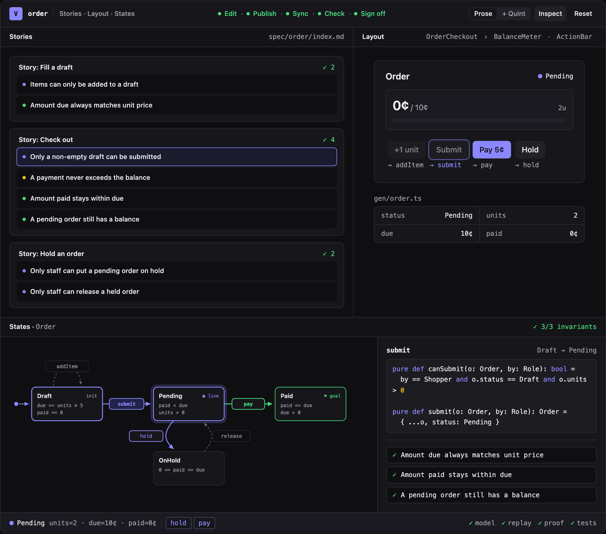
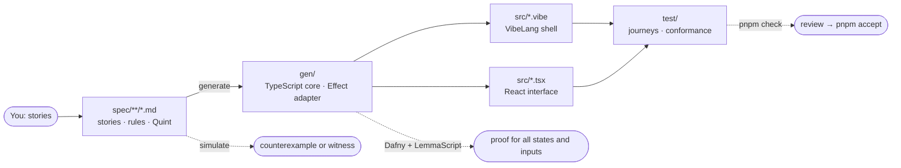

<div align="center">

# Vibestack

**Ship apps. Not slop.**

Build formally verified full-stack applications in English.<br />
What you want is what you get.

[vibestack.fun](https://vibestack.fun) ·
[SKILL.md](https://vibestack.fun/SKILL.md) ·
[Quickstart](#quickstart) ·
[The stack](#the-stack) ·
[Studio](#studio) ·
[Commands](#commands) ·
[Examples](#examples)

</div>

[](https://vibestack.fun)

## Quickstart

**Paste into your agent:**

```text
Read https://vibestack.fun/SKILL.md and create a new project.
```

[-18181B?style=for-the-badge)](https://chatgpt.com/?q=Read%20https%3A%2F%2Fvibestack.fun%2FSKILL.md%20and%20create%20a%20new%20project.)
[](https://claude.ai/new?q=Read%20https%3A%2F%2Fvibestack.fun%2FSKILL.md%20and%20create%20a%20new%20project.)
[](https://grok.com/?q=Read%20https%3A%2F%2Fvibestack.fun%2FSKILL.md%20and%20create%20a%20new%20project.)
[](https://cursor.com/link/prompt?text=Read%20https%3A%2F%2Fvibestack.fun%2FSKILL.md%20and%20create%20a%20new%20project.)
[](https://www.meta.ai/?prompt=Read%20https%3A%2F%2Fvibestack.fun%2FSKILL.md%20and%20create%20a%20new%20project.)

For an existing repository, paste: `Read https://vibestack.fun/SKILL.md and upgrade an existing project.`

**Or run from the terminal** (requires Node 26+ and [pnpm](https://pnpm.io)):

```bash
# New project (or scaffold an example: order | dashboard | fullstack | assistant)
pnpm create vibestack my-app
cd my-app && pnpm exec vibestack doctor --install-dafny && pnpm dev

# Launch Vibestack Studio on any project with spec/
pnpm dlx vibestack-studio
```

## The stack

Stories and rules live in `spec/**/*.md` with formal [Quint](https://quint-lang.org) underneath. `gen/` is derived, simulated, and proved with [Dafny](https://dafny.org) and [LemmaScript](https://github.com/midspiral/LemmaScript). Effects run in [VibeLang](https://github.com/smithersai/vibelang) on [Effect](https://effect.website), interfaces in [React](https://react.dev) + [Tailwind](https://tailwindcss.com) + [shadcn/ui](https://ui.shadcn.com), and real journeys in Vitest, [Storybook](https://storybook.js.org), [Bombadil](https://github.com/antithesishq/bombadil), and [ESLint](https://eslint.org).



| Layer | Owns | Verified by |
| --- | --- | --- |
| Requirements | Stories and rules in `spec/**/*.md`, edited in Markdown or [Studio](#studio) | `review` → `pnpm accept` |
| Model | Quint state, transitions, `always` / `step` / `sometimes` / `leadsTo` rules, laws | `model`, `always`, `sometimes` |
| Generated core | `gen/<name>.ts`, `gen/<name>.effect.vibe` (`Machine`), `gen/<name>.react.ts` | `replay`, `proof` (Dafny + LemmaScript) |
| Shell | HTTP, storage, queues, I/O in VibeLang on Effect 4 (or plain TS in `typescript` mode) | `types` (`vibelang` / `tsc`) |
| Interface | React, Vite, Tailwind v4, shadcn/ui on Radix, `@repo/design-system` tokens | `types`, ESLint token rules, Storybook |
| Tests | Vitest + Playwright journeys, spec conformance drivers, Bombadil page exploration | `tests`, `traces`, `explore` |

Agents follow [AGENTS.md](AGENTS.md), [SPEC.md](SPEC.md), and [`.agents/skills/`](.agents/skills/), iterating on `pnpm check` until only your sign-off (`pnpm accept`) remains. See [CONTRIBUTING.md](CONTRIBUTING.md#architecture) for caching, test policy, and CI details.

## Studio

```bash
pnpm dlx vibestack-studio                  # open Vibestack Studio on the current project
npx vibestack-studio ./path/to/project     # open Vibestack Studio on any directory with spec/
pnpm dev                                   # in a scaffolded app: Studio + app dev servers
```

`vibestack-studio` is a standalone package with zero runtime npm dependencies and a prebuilt React UI. Inspect and edit **Stories**, live **Layout** previews, and interactive **States** graphs side by side, run checks, and sign off directly in the browser.

## Add to an existing project

`vibestack init` is non-destructive and auto-detects `vibelang` vs. plain `typescript` mode (pass `--mode vibelang|typescript|specs-only` or `--exclude <dirs>` to customize):

```bash
pnpm add -D vibestack
pnpm exec vibestack init
pnpm exec vibestack doctor --install-dafny
pnpm exec spec new
pnpm check
```

Upgrade an existing project to the latest release without clobbering custom edits:

```bash
pnpm vibestack upgrade                     # upgrade to latest release
pnpm exec vibestack upgrade --dry-run      # preview managed file updates first
```

## Configuration

Configure Vibestack in an optional root `vibestack.json` (or under `"vibestack"` in `package.json`):

```json
{
  "mode": "vibelang",
  "spec": {
    "dir": "spec",
    "exclude": ["models", "product"],
    "owners": { "assistant": "packages/plugin-assistant" }
  },
  "cacheDir": ".spec-cache",
  "stages": { "types": "vibelang", "tests": "vitest", "explore": "auto" }
}
```

## Commands

`vibestack` and `spec` are identical binaries provided by the `vibestack` package.

| Command | Does |
| --- | --- |
| `pnpm create vibestack <name> [--example order\|dashboard\|fullstack\|assistant]` | Scaffolds a clean project from `template/` or a standalone example |
| `pnpm exec vibestack init [<dir>] [--mode vibelang\|typescript\|specs-only]` | Non-destructively initializes an existing repository |
| `pnpm vibestack upgrade [version] [--dry-run]` | Upgrades `vibestack`, refreshes managed skills/docs, and aligns toolchain pins |
| `pnpm exec vibestack doctor [--install-dafny]` | Checks Node 26+, pnpm, Dafny 4.11, Quint, Chromium, and installs Dafny 4.11 if missing |
| `pnpm dlx vibestack-studio [<dir>]` / `npx vibestack-studio [<dir>]` | Launches standalone Vibestack Studio on any project with `spec/` |
| `pnpm dev` | Starts Vibestack Studio and every workspace package's `dev` script together |
| `pnpm check [<dir>] [--json] [--timings]` | Runs generation, simulation, proofs, types, tests, conformance, and exploration |
| `pnpm gen [<dir>]` | Generates `gen/` only |
| `pnpm accept [<dir>]` | User sign-off: checks afresh and records reviewed rules in `spec/lock.json` |
| `pnpm new [<path>]` | Fills an empty root spec or creates a starter `spec/<path>/index.md` |
| `pnpm quick` | Fast local types, lint, and tests of changed packages |
| `pnpm verify` | Full CI suite: build, types, tests, browser tests, checks, lint, analyze, selftests |

## Examples

Each example is a standalone project consuming `vibestack` as a package:

| Project | What it covers | Scaffold / Open in Studio |
| --- | --- | --- |
| [Order checkout](examples/order/README.md) | Guards, payments, cancellation, and a proved event ledger | `pnpm create vibestack demo --example order` · `pnpm dlx vibestack-studio examples/order` |
| [Team dashboard](examples/dashboard/README.md) | Shared spreadsheets, chat notifications, and a project registry | `pnpm create vibestack demo --example dashboard` · `pnpm dlx vibestack-studio examples/dashboard` |
| [Shared to-do list](examples/fullstack/README.md) | HTTP server, browser client, and two tabs over an unreliable network | `pnpm create vibestack demo --example fullstack` · `pnpm dlx vibestack-studio examples/fullstack` |
| [Assistant](examples/assistant/README.md) | Trusted senders, bounded turns, confirmation before payment, secret card | `pnpm create vibestack demo --example assistant` · `pnpm dlx vibestack-studio examples/assistant` |

## Repository

| Path | Holds |
| --- | --- |
| `packages/vibestack` | Published as `vibestack`: CLI, generator, simulator, prover, testing/design/eslint exports, and bundled skills |
| `packages/studio` | Published as `vibestack-studio`: standalone Vibestack Studio server and prebuilt React UI |
| `packages/create-vibestack` | Published as `create-vibestack`: project scaffolder bundling `template/` |
| `apps/site` | Marketing landing page deployed to [vibestack.fun](https://vibestack.fun) |
| `template/` | Starter workspace (`template/apps/app`, `template/packages/design-system`, `template/packages/ui`, `template/spec/`) |
| `examples/` | Standalone example applications (`examples/order`, `examples/dashboard`, `examples/fullstack`, `examples/assistant`) |
| `selftest/` | Tool self-tests, docs/example checks, and spec fixtures |
| `.agents/skills/` | Canonical agent skills and references |

## Contributing

See [CONTRIBUTING.md](CONTRIBUTING.md).

## License

[MIT](LICENSE)
